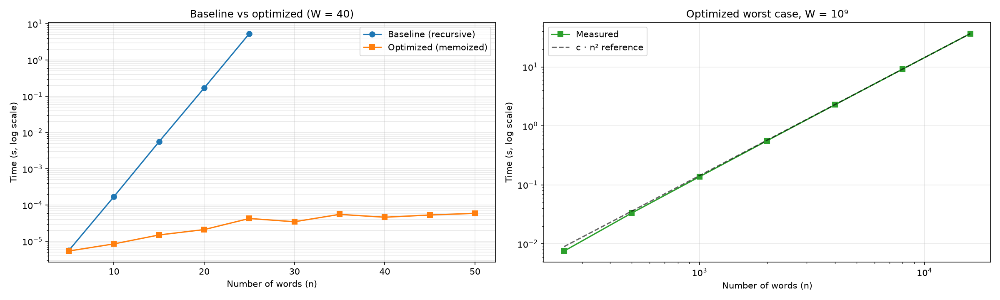

# Empirical Evaluation

## Overview

We implemented our two algorithms (`src/linebreak.py`) that solve the Line Breaking problem:

1. **Baseline Algorithm:** A plain recursive approach that, for each starting word, tries every line that fits within the width and recurses on the remaining words.
2. **Optimized Algorithm:** The same recursion as the Baseline Algorithm, plus a memo table keyed by the starting word index, so each suffix of the word list is solved only once.

Both algorithms return the minimum total penalty, where each non-last line costs 3 times its slack (the width minus the line's length) and the last line is free, or `inf` when some word is longer than the width. The plot legends label the algorithms as Baseline (recursive) and Optimized (memoized).

Unit testing (`src/test_linebreak.py`) confirms that both algorithms return the correct minimum penalty across 21 typical and edge cases (empty lists, words longer than the width, etc.). Both algorithms also match an independent brute-force oracle on hundreds of random inputs.

## Benchmarking Results

We compare the performance of our two algorithms on randomly generated inputs (`src/benchmark.py`) in two experiments: the first runs both algorithms on small inputs (n = 5 to 50 words) with a line width of 40, and the second runs only the Optimized Algorithm on much larger inputs (n = 250 to 16,000 words) with a width of 10^9. Word lengths are sampled from 2 to 8 characters with a fixed random seed. Each input size was run ten times, and the fastest time was used for the plots and subsequent analysis. We present the results in the plots below.

In the first experiment (left plot), a width of 40 fits roughly 7 words per line, and the y axis is logarithmic because the two algorithms differ by orders of magnitude. The Baseline Algorithm takes about 0.0002 seconds at n = 10, 0.006 seconds at n = 15, 0.17 seconds at n = 20, and 5.39 seconds at n = 25. Since that exceeded our 5 second cap, we did not run it beyond n = 25. The Optimized Algorithm, in contrast, stays under 0.06 milliseconds all the way to n = 50. Each additional 5 words multiplies the Baseline Algorithm's time by about 31 (ratios of 33, 30, and 32), which is roughly a doubling for every added word and appears as a straight line on the logarithmic axis.

In the second experiment (right plot), we set the width to 10^9, far larger than the total length of any input we generate, so that every word fits on a single line. This is the worst case for the Optimized Algorithm. In `planning.md`, we predicted a worst-case running time of $\Theta(n^2)$ for the Optimized Algorithm. Each starting position is solved only once, and in the worst case every word fits on one line, so the loop for the starting word at position $i$ checks all of the remaining words and never breaks early. The maximum number of checks is therefore $n + (n-1) + \cdots + 1 = \frac{n(n+1)}{2}$, and since each check takes constant time, the running time grows as $n^2$. With a normal width, the loop would break after a handful of words, so the 10^9 width is what allows us to reach this worst case instead of measuring a faster one. Both axes of this plot are logarithmic, so a running time of the form $n^c$ appears as a straight line of slope $c$. The measured line approaches a slope of 2 at larger inputs: the slope between consecutive input sizes falls from 2.14 (n = 250 to 500) to 2.00 (n = 8,000 to 16,000), and is 2.04 over the whole range. It also runs parallel to the dashed c · n² reference line, where c is fitted to the measurement at the largest input. The Optimized Algorithm takes 0.0075 seconds at n = 250, 0.14 seconds at n = 1,000, 2.28 seconds at n = 4,000, and 36.7 seconds at n = 16,000.

The empirical data aligns with our theoretical complexity analysis (`planning.md`):

- **Baseline Exponential Scaling**: The Baseline Algorithm has a worst-case upper bound of $\mathcal{O}(2^n)$ because it recomputes the same suffixes many times: with short words and a wide line, every gap between words can independently be a line break or not. The measured growth of about 2 times per added word matches this, and the algorithm becomes unusable at around 25 words, where it already takes 5.39 seconds. Its stack space is only $\mathcal{O}(n)$, since the recursion depth is at most one level per word.
- **Optimized Efficiency**: The Optimized Algorithm solves each of the $n$ suffixes of the word list only once, which removes the repeated work of the Baseline Algorithm and leaves $\mathcal{O}(n^2)$ time in the worst case and $\mathcal{O}(n)$ space. At n = 25, it is about **126,000 times faster** than the Baseline Algorithm (0.0000427 seconds versus 5.39 seconds), demonstrating the advantage of memoizing overlapping subproblems instead of recomputing them.
- **Quadratic Worst Case**: The $\Theta(n^2)$ worst case predicted in `planning.md` ($\frac{n(n+1)}{2}$ constant-time checks) is reached when the width is large enough for all words to share one line, which is why the second experiment uses a width of 10^9. The log-log plot confirms it: the measured slope approaches 2 as the input grows, meaning the running time approaches $n^2$ at large word counts.
